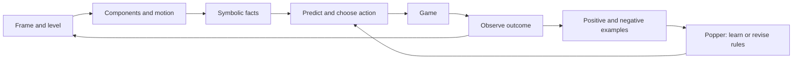

# Agent 2

An interactive ARC-AGI-3 agent that learns symbolic transition rules with
[Popper](https://github.com/logic-and-learning-lab/Popper). It works from public
pixel grids, available action IDs, and level numbers, using CPU-only perception,
online example generation, and bounded planning.

The recorded implementation cleared **LS20 level 1 in 59 and 60 actions** in two
local runs. Both runs continued into level 2 and ended in game over. See
[experiment results](results/README.md) for successes, failures, and limitations.

**Research scope:** the learned theory starts empty, but the agent has programmed
geometric assumptions. Development was informed by LS20 and other public-game
observations. These are development results, not a blind evaluation or evidence
of a general ARC solver. No game-specific rules, palette roles, goal location,
or solution path are loaded by the agent.

## Install

Requirements: **Python 3.14**, Git, a C/C++ build toolchain, and **SWI-Prolog with
Janus support**. The experiments used SWI-Prolog 10.0.2. Popper's pinned revision
requires Python 3.14; the default Python on Linux Mint may be older.

On Linux Mint / Ubuntu, install SWI-Prolog using the
[official PPA instructions](https://www.swi-prolog.org/build/PPA.html), and install
the compiler tools:

```bash
sudo apt install build-essential git
```

With [uv](https://docs.astral.sh/uv/getting-started/installation/) installed, run
these commands **from this repository directory**:

```bash
uv python install 3.14
uv venv --python 3.14
source .venv/bin/activate
uv pip install -r requirements.txt
arc-agent2 doctor
```

Alternatively, use an existing Python 3.14 environment with
`python -m pip install -r requirements.txt`. `doctor` prints dependency versions
and checks the Python-to-Prolog connection. If that check fails, verify the
SWI-Prolog installation before running experiments.

Dependencies are declared once in [pyproject.toml](pyproject.toml).
Popper and the ARC toolkit are installed from pinned upstream Git revisions;
their source trees are not bundled here. Native SWI-Prolog is installed separately.
The direct dependency revisions match the experiments; the recorded transitive
environment is in [results/environment.json](results/environment.json).

## Download and run a game

Obtain an API key from [ARC Prize](https://three.arcprize.org) if required for the
games you want to download. Keep it in your shell environment:

```bash
read -rsp 'ARC API key: ' ARC_API_KEY
export ARC_API_KEY
arc-agent2 download ls20
```

The download command uses the official toolkit's normal mode, which obtains a
local environment. The runner subsequently uses **offline mode**:

```bash
arc-agent2 run ls20 --budget 200 --seed 0 --out runs/ls20-seed0
arc-agent2 run ft09 --budget 80 --out runs/ft09
```

Use a new output directory for each run. Existing directories are not overwritten.
To use games downloaded elsewhere:

```bash
arc-agent2 run ls20 --environments-dir /path/to/environment_files \
  --budget 200 --out runs/ls20
```

`--max-fits` (default 40) bounds induction attempts, and `--fit-timeout` (default
8 seconds) bounds each Popper search. The agent continues across level transitions
and stops at the action budget, win, or game over. It performs no manual resets.
This command is a local experiment runner, not a competition-mode submission.

Each run saves:

- `result.json`: outcomes, prediction counts, and induction audits.
- `trace.json`: actions and predictions recorded before observing outcomes.
- `knowledge.pl`: the current learned programs, requiring observation facts to query.
- `learning/`: generated examples, background facts, bias, hypotheses, and solver audits.
- `frames.npz`, `recordings/`: observations from that run.
- `manifest.json`: package versions, source hashes, and run parameters.

Game files, credentials, environments, and new runs are excluded by `.gitignore`.
The runner never reads the bundled historical experiment results as training data.

## How it works



The agent groups pixels into components, estimates action-related translations,
and proposes changing bitmap regions. Popper learns conditional movement and
next-pixel rules. Exploration favors unfamiliar contexts and tests untried
negative predictions. A level increase supplies a positive example for a
candidate progress predicate. Learned programs are retained across levels and
checked against new observations before bitmap reuse.

The controller uses an empirical table for basic action displacements. Popper's
nontrivial contribution is conditional logic and pixel-coordinate programs;
the entire system should not be described as exclusively ILP.

## Python interface

```python
from pathlib import Path
from arc_agent2 import Agent2

agent = Agent2(Path("runs/example/learning"), seed=0)
agent.observe(grid, levels_completed, available_action_ids)
action_id, coordinate_data = agent.choose()
# Execute the action, then call observe() with the resulting public observation.
```

The agent does not receive the game ID. ACTION6 uses click coordinates according
to the ARC API convention. `python -m arc_agent2` provides the same CLI as
`arc-agent2`.

## Limitations

The current representation assumes component-like objects, mostly static terrain,
and useful small square regions. It supports two active bitmap channels, bounded
search, and a limited rule vocabulary. It does not reliably model timers, life
loss, resets, camera motion, or changing sprite identities. Contradictory labels
cause abstention; the agent does not automatically invent the missing state variable.

One successful transition supplies a candidate goal explanation, not proof of the
goal rule. Breadth-first search finds short paths in the searched learned model;
it does not guarantee the environment's true shortest solution. There is no CNN,
LLM, RL comparison, or MDL exploration objective in this implementation.

## Development

```bash
uv pip install -e '.[dev]'
ruff check .
ruff format --check .
python -m unittest discover -s tests -v
```

The tests exercise actual Popper induction, contradiction handling, click inversion,
and goal reuse in synthetic two-level worlds. They need SWI-Prolog, but no ARC key
or downloaded games. Test artifacts are created in temporary directories.

Code lives in `src/arc_agent2/`: `agent.py` coordinates the loop, `perception.py`
and `components.py` interpret grids, `learning.py` generates and checks theories,
`logic.py` supplies shared logical utilities, and `cli.py` owns environment access.
`worker.py` isolates each Popper search in its own process.

This repository is a standalone refactoring of the recorded Agent 2 prototype.
Historical experiment provenance is preserved under `results/`; packaging
verification is documented separately there. Installation downloads upstream
dependencies and does not require the original development workspace.
